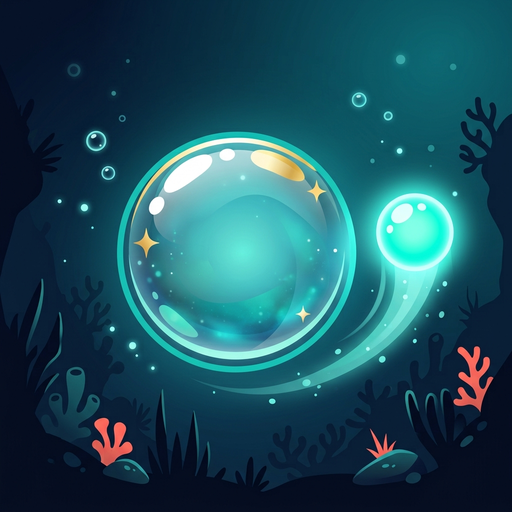
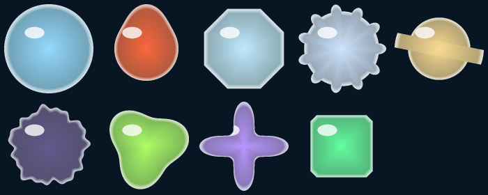
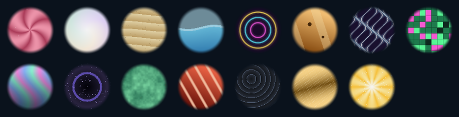
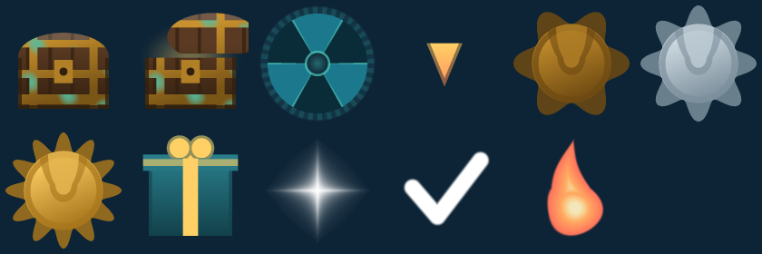
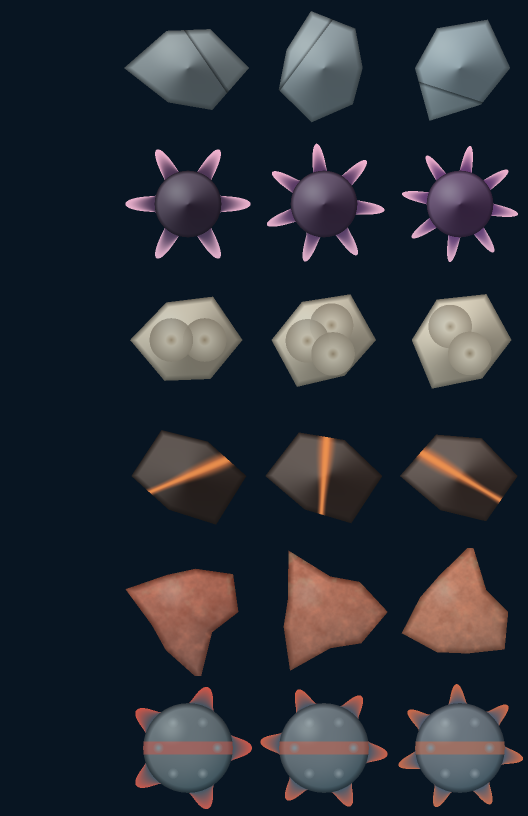
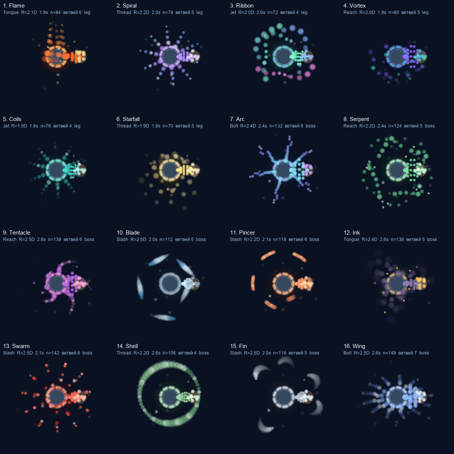

# Bubble Rise: Ascent

**Пузырёк: Подъём из глубин**

  
  
  
  
  
  

**A fragile bubble rises on its own. You are not the bubble — you are what stands in the way.**

*Хрупкий пузырёк всплывает сам. Вы не пузырёк — вы то, что встаёт на пути.*

**[English](#english)** · **[Русский](#русский)** · [Build](docs/BUILD.md) · [Design notes](docs/DESIGN.md)

---

## Not one art file · Ни одного файла с 

Every pixel below was produced by the C# that ships in this repository. There are no PNGs of
enemies, skins or icons anywhere in the build — just functions of position, angle and time.
The sheets here are rendered by the Python ports in `Tools/`, which reproduce the same maths
outside Unity, and **every one of them regenerates with a single command.**

*Каждый пиксель ниже нарисован тем кодом на C#, который лежит в этом репозитории. Ни одного
PNG с врагами, скинами или значками в сборке нет — только функции от точки, угла и времени.
Листы здесь рисуют порты на Python из `Tools/`, повторяющие ту же математику вне Unity, и
**любой из них перерисовывается одной командой.***

<table>
<tr><td align="center">
  
   <b>Shapes</b> · <b>Формы</b>
   Sphere, Drop, Faceted, Spiky, Ringed, Wisp, Lumpy, Star, Blocky — each silhouette is a radius function of the angle 
  Девять силуэтов пузырька и стража: каждый — функция радиуса от угла, а не файл
   <code>python3 Tools/preview_shapes.py</code>
</td></tr>
<tr><td align="center">
  
   <b>Materials</b> · <b>Материалы</b>
   coral · pearl · sand · tide · neon · resin · plasma · pixel · aurora · abyss · verdigris · cinnabar · obsidian · brass · starlight 
  Скин — это форма плюс материал, поэтому их много, а весят они ноль байт
   <code>python3 Tools/preview_materials.py</code>
</td></tr>
<tr><td align="center">
  
   <b>Rewards</b> · <b>Награды</b>
   Chest, wheel, pointer, three medals, gift, sparkle, tick, flame — the interface is drawn by the same factory as the enemies 
  Сундук, колесо, медали, подарок — интерфейс рисует та же фабрика, что и врагов
   <code>python3 Tools/preview_rewards.py</code>
</td></tr>
<tr><td align="center">
  
   <b>Hazards</b> · <b>Препятствия</b>
   Stone, urchin, growth, ember, coral, mine. The generator reseeds for every one, so two stones never match 
  Камень, ёж, нарост, уголёк, коралл, мина — генератор берёт новое зерно, одинаковых не бывает
   <code>python3 Tools/preview_hazards.py</code>
</td></tr>
<tr><td align="center">
  
   <b>Collision envelopes</b> · <b>Оболочки столкновения</b>
   The debug sheet: sixteen envelopes of legendary and boss skins, one frame each at <i>t</i> = 0.9 s, with reach, period and particle count 
  Отладочный лист: шестнадцать оболочек легендарных и боссовых скинов — ровно то, что игра рисует вокруг стража
   <code>python3 Tools/preview_envelopes.py</code>
</td></tr>
</table>

---

## English

An underwater reflex arcade for Yandex Games and Google Play. The bubble rises by itself
and cannot be steered. You drag the **guardian** — a glowing orb — with a mouse or finger
and put it between the bubble and everything coming at it.

**Not one art or audio file.** Every sprite is drawn in code, every sound is synthesised in
code. The build ships zero bytes of assets, and the rights are clean by construction.

### At a glance

| | |
|---|---|
| **10 bosses** | each tests a different skill; the last one tests all of them |
| **36 skins per half** | bubble and guardian are dressed separately — depth rewards, boss trophies, collection prizes |
| **5 locations** | canyon, kelp forest, sunken city, trench, shoal |
| **31 sounds** | 27 effects plus ambient, menu, boss and finale loops — all synthesised |
| **2 languages** | Russian and English, switched on the fly |
| **~41 000 lines** | 99 C# files, no prefabs, no inspector references |

### The one rule

The guardian cannot stand still. After every block it dims for a third of a second and
lets hits through, and threats arrive from several directions at once. It also cannot hug
the bubble — a minimum distance is enforced.

Everything else follows from that rule. Without it, *park the orb above the bubble and go
make tea* would be a winning strategy.

### Bosses

| Depth | Boss | What it tests |
|---:|---|---|
| 1 000 m | Storm Jellyfish | **reflection** — put the guardian in the bolt's path and it goes back |
| 2 000 m | Abyss Serpent | **positioning** — it cuts the screen, then strikes along the lit line |
| 3 000 m | Abyss Blade | **reaction** — enters from off-screen, arrows show from where |
| 4 000 m | Stone Shells | **circular rhythm** — turtles ring you and throw rocks in turn |
| 5 000 m | Piranha Swarm | **reading formation** — wedge then singles; one blocked is one fish fewer |
| 6 000 m | Ink Shroud | **orientation** — floods the screen and throws the guardian into a corner |
| 7 000 m | Deep Kraken | **priorities** — tentacle volleys you cannot fully cover; choose |
| 8 000 m | Pincer Beast | **switching** — blocking is not enough, you must strike the claw's target |
| 9 000 m | White Death | **changing tactics** — ambushes; once the jaws open, run for ten seconds |
| 10 000 m | **The Great Shadow** | **everything** — three acts, damaged only by reflecting its own bolts |

Bosses sit on round marks, not on a random schedule: 3 000 m is always the third one, so
the player knows who is waiting and prepares. Clear the row and it restarts harder — the
jellyfish at 11 000 m has double health and is enraged from the first second, triple at
21 000 m. The ceiling is not the boss list; it is how long the player lasts.

### How it is built

| Principle | What it means in the repository |
|---|---|
| **Everything in code** | the scene holds a camera, a light and one `Game` object; the rest is assembled in `Awake()`. No prefabs, no inspector links, nothing to lose in a merge |
| **Procedural sprites** | `SpriteFactory` draws each sprite in normalised coordinates and caches it. A new enemy is a colour function, not a file |
| **Procedural audio** | oscillator → ADSR → low-pass → reverb → normalise; loops are stitched without a click at the seam |
| **No Physics2D** | collisions are circle-overlap checks, tick order is explicit in `GameManager.Update()`, fast objects move in substeps so they cannot tunnel through the guardian |
| **One branch, two stores** | the platform is chosen **at build time** in `GameBootstrap.CreatePlatform()`, so Yandex code never reaches the phone package |
| **UI in code too** | legacy uGUI, canvas scales by height: reference height is always 1280, width floats |

### Eye-safety rules

The owner gets headaches from flashing, so these are hard limits, not taste. `Tools/audit.py`
measures them and fails the build if they are broken.

| Rule | Limit |
|---|---|
| Full-screen flashes | none |
| Hit-stop, strobing, camera shake | none |
| Sharp brightness changes | at most 3 per second |
| White blowout | none — peak brightness stays below it |
| Effect fade-in | not faster than 0.15–0.2 s |
| Effect fade-out | 0.4–0.6 s |
| Glow pulsation | no faster than one cycle per 1.5–2 s |

### Repository layout

| Path | What is inside |
|---|---|
| `Assets/Scripts/` | 94 runtime files: game loop, bosses, spawners, UI, audio, platform SDKs |
| `Assets/Scripts/Editor/` | 5 editor files: project setup, build menu, skin and envelope checks |
| `Assets/Icons/` | launcher icons |
| `Assets/Resources/` | `Inter-Regular.ttf` — the only third-party file |
| `Assets/WebGLTemplates/` | Yandex Games template: SDK bridge, pause, ads |
| `Assets/Scenes/Main.unity` | camera, light, one `Game` object — nothing else |
| `Tools/` | 18 Python tools: checks, previews, simulations, builds |
| `BuildSetup/` | `AdUnits.Example.cs` — template for ad unit ids |
| `docs/` | design notes, build instructions, privacy policy |
| `docs/images/` | the sheets above, as produced by `Tools/preview_*.py` |

### Build

Full instructions: **[docs/BUILD.md](docs/BUILD.md)**. In short:

1. Unity **6000.2.13f1** with Android Build Support (WebGL only for the Yandex build).
2. Import **Google Mobile Ads for Unity** — it is not in the repository, it is third-party code.
3. Copy `BuildSetup/AdUnits.Example.cs` → `Assets/Scripts/AdUnits.cs`. As shipped it builds
   and runs: every slot holds a Google test unit.
4. Set your own package name, keystore and privacy policy URL.
5. `python3 Tools/build.py` — checks, build and a console-ready archive.

### Checks without the editor

| Command | What it does |
|---|---|
| `python3 Tools/check.py` | compiles both script assemblies with the Roslyn bundle shipped inside Unity, plus `node --check` on the WebGL template |
| `python3 Tools/audit.py` | ~300 publication-readiness checks: localisation, economy, layout, effects, eye-safety limits |
| `python3 Tools/preview_*.py` | renders the sprite maths to PNG with the same code the game uses — this is where the sheets above come from |
| `python3 Tools/simulate_*.py` | replays the reward economy and the obstacle generator from the config numbers |

Both return a non-zero exit code on failure and are fit for CI. They do not replace playing
the game, but they catch regressions in seconds without opening the editor. The previews need
[Pillow](https://pypi.org/project/Pillow/); nothing else has dependencies outside the standard library.

### License

| What | Terms |
|---|---|
| Code — C#, editor tools, Python in `Tools/` | [MIT](LICENSE) |
| Inter font (`Assets/Resources/`) | [SIL Open Font License 1.1](https://scripts.sil.org/OFL) — its own licence, not MIT |
| App icons (`Assets/Icons/`), site page (`docs/site/`) | **all rights reserved**, not covered by MIT |
| Preview sheets (`docs/images/`) | output of the MIT tools in `Tools/`, so MIT covers them too |
| Everything else visual and audible | exists only as the code that draws and synthesises it, so MIT covers it too |

The name *Bubble Rise: Ascent* and the store pages belong to the author. A fork must use its
own package name, its own keystore and its own store page.

---

## Русский

Подводная аркада на реакцию для Яндекс Игр и Google Play. Пузырёк всплывает сам, управлять
им нельзя. Вы таскаете мышью или пальцем **стража** — светящийся шарик — и подставляете его
под всё, что летит навстречу.

**Ни одного файла с графикой или звуком.** Каждый спрайт рисуется кодом, каждый звук
синтезируется кодом. В сборке это ноль байт ассетов и полная чистота прав.

### Коротко

| | |
|---|---|
| **10 боссов** | каждый проверяет свой навык, последний — все сразу |
| **36 скинов на половину** | пузырёк и страж одеваются отдельно: за глубину, трофеи с боссов, награды за коллекцию |
| **5 локаций** | каньон, ламинариевый лес, затонувший город, впадина, отмель |
| **31 звук** | 27 эффектов плюс эмбиент, меню, боевая и финальная темы — всё синтезом |
| **2 языка** | русский и английский, переключаются на лету |
| **~41 000 строк** | 99 файлов C#, ни префабов, ни ссылок в инспекторе |

### Главное правило

Страж не может стоять на месте. После каждого отбитого объекта он на треть секунды тускнеет
и пропускает удары, а угрозы идут с нескольких сторон. Прижаться к пузырьку тоже нельзя —
страж держит минимальную дистанцию.

Из этого правила выведена вся игра. Без него «поставил шарик над пузырьком и пошёл пить
чай» было бы выигрышной стратегией.

### Боссы

| Глубина | Босс | Что проверяет |
|---:|---|---|
| 1 000 м | Грозовая медуза | **отражение** — подставить стража под молнию, и разряд уйдёт обратно |
| 2 000 м | Змей бездны | **позиционирование** — режет экран, потом бьёт рывком по подсвеченной линии |
| 3 000 м | Клинок бездны | **реакцию** — заходит из-за края экрана, стрелки показывают откуда |
| 4 000 м | Каменный панцирь | **круговой ритм** — черепахи встают кольцом и метают камни по очереди |
| 5 000 м | Стая пираний | **чтение строя** — клином и по одному; один отбитый — минус одна рыба |
| 6 000 м | Чернильный морок | **ориентацию** — заливает экран и забрасывает стража в угол |
| 7 000 м | Спрут глубин | **приоритеты** — серии щупалец, закрыть все нельзя; выбирайте |
| 8 000 м | Клешнерук | **переключение** — мало закрыться, нужно ударить в мишень клешни |
| 9 000 м | Белая смерть | **смену тактики** — бьёт из засады; раскрыла пасть — уводи стража десять секунд |
| 10 000 м | **Великая тень** | **всё сразу** — три акта, урон только отражением её же разрядов |

Боссы стоят на круглых отметках, а не по случайному расписанию: на 3 000 м всегда третий,
и игрок знает, кто его ждёт. Пройден весь ряд — он начинается заново, но тяжелее: на
11 000 м снова медуза, с удвоенным запасом здоровья и сразу разъярённая, на 21 000 — втрое.
Потолок игры не в списке боссов, а в том, сколько игрок выдержит.

### Как это устроено

| Принцип | Что это значит в репозитории |
|---|---|
| **Всё строится кодом** | в сцене камера, свет и один объект `Game`; остальное собирается в `Awake()`. Ни префабов, ни ссылок в инспекторе, нечего потерять при мерже |
| **Спрайты процедурные** | `SpriteFactory` рисует каждый в нормализованных координатах и кэширует. Новый враг — это функция цвета от точки, а не файл |
| **Звук процедурный** | генератор → ADSR → фильтр нижних частот → ревербация → нормализация; петли сшиваются без щелчка на стыке |
| **Без Physics2D** | столкновения — проверки перекрытия кругов, порядок тиков задан явно в `GameManager.Update()`, быстрые объекты идут подшагами и не проскакивают сквозь стража |
| **Одна ветка, две площадки** | платформа выбирается **при сборке** в `GameBootstrap.CreatePlatform()`, поэтому код Яндекса в пакет для телефона не попадает вовсе |
| **Интерфейс тоже кодом** | legacy uGUI, канвас тянется по высоте: опорная высота всегда 1280, ширина плавает |

### Правила для глаз

У владельца от вспышек болят глаза, поэтому это не вкусовые пожелания, а жёсткие пределы.
`Tools/audit.py` их измеряет и роняет сборку, если они нарушены.

| Правило | Предел |
|---|---|
| Вспышки на весь экран | нет |
| Hit-stop, строб, тряска камеры | нет |
| Резкие изменения яркости | не больше 3 в секунду |
| Белый пересвет | нет — пиковая яркость до него не доходит |
| Появление эффекта | не быстрее 0.15–0.2 с |
| Затухание эффекта | 0.4–0.6 с |
| Пульсация свечения | не быстрее одного цикла за 1.5–2 с |

### Структура

| Путь | Что внутри |
|---|---|
| `Assets/Scripts/` | 94 файла рантайма: игровой цикл, боссы, спавнеры, интерфейс, звук, SDK площадок |
| `Assets/Scripts/Editor/` | 5 файлов редактора: настройка проекта, меню сборки, сверки скинов и оболочек |
| `Assets/Icons/` | иконки приложения |
| `Assets/Resources/` | `Inter-Regular.ttf` — единственный сторонний файл |
| `Assets/WebGLTemplates/` | шаблон Яндекс Игр: мост к SDK, пауза, реклама |
| `Assets/Scenes/Main.unity` | камера, свет и один объект `Game` — больше ничего |
| `Tools/` | 18 инструментов на Python: проверки, предпросмотр, симуляции, сборка |
| `BuildSetup/` | `AdUnits.Example.cs` — шаблон рекламных блоков |
| `docs/` | документация, инструкция по сборке, политика конфиденциальности |
| `docs/images/` | листы предпросмотра выше — то, что рисует `Tools/preview_*.py` |

### Сборка

Подробно — **[docs/BUILD.md](docs/BUILD.md)**. Коротко:

1. Unity **6000.2.13f1** с модулем Android Build Support (WebGL — только для сборки под Яндекс).
2. Импортировать **Google Mobile Ads for Unity** — в репозитории его нет, это чужой код.
3. Скопировать `BuildSetup/AdUnits.Example.cs` → `Assets/Scripts/AdUnits.cs`. Как есть он
   собирается и работает: всюду тестовые блоки Google.
4. Свои имя пакета, keystore и ссылка на политику конфиденциальности.
5. `python3 Tools/build.py` — проверки, сборка и архив для консоли.

### Проверки без редактора

| Команда | Что делает |
|---|---|
| `python3 Tools/check.py` | компилирует обе сборки скриптов бандлом Roslyn из самой Unity плюс `node --check` для шаблона WebGL |
| `python3 Tools/audit.py` | ~300 проверок готовности к публикации: локализация, экономика, раскладка, эффекты, пределы безопасности для глаз |
| `python3 Tools/preview_*.py` | рисует математику спрайтов в PNG тем же кодом, что и игра — отсюда взяты листы выше |
| `python3 Tools/simulate_*.py` | прогоняет экономику наград и генератор препятствий по числам из конфига |

Обе возвращают ненулевой код при провале и годятся для CI. Запуск игры они не заменяют, но
ловят регрессии за секунды и не требуют открытого редактора. Предпросмотру нужен
[Pillow](https://pypi.org/project/Pillow/); больше ничто за пределы стандартной библиотеки
не выходит.

### Лицензия

| Что | Условия |
|---|---|
| Код — C#, инструменты редактора, Python в `Tools/` | [MIT](LICENSE) |
| Шрифт Inter (`Assets/Resources/`) | [SIL Open Font License 1.1](https://scripts.sil.org/OFL) — собственная лицензия, не MIT |
| Иконки приложения (`Assets/Icons/`), страница сайта (`docs/site/`) | **все права защищены**, под MIT не подпадают |
| Листы предпросмотра (`docs/images/`) | вывод инструментов из `Tools/`, которые под MIT, — значит, и они тоже |
| Всё остальное видимое и слышимое | существует только в виде кода, который его рисует и синтезирует, и подпадает под MIT вместе с ним |

Название *Пузырёк: Подъём из глубин* и страницы в магазинах принадлежат автору. Форк обязан
использовать своё имя пакета, свой keystore и свою страницу в магазине.

---

<a href="https://github.com/ars6nlp"><b>ars6nlp</b></a> ·
<a href="https://github.com/ars6nlp/BubbleRise">github.com/ars6nlp/BubbleRise</a> ·
<a href="https://play.google.com/store/apps/details?id=com.bubblerise.ascent">Google Play</a>

